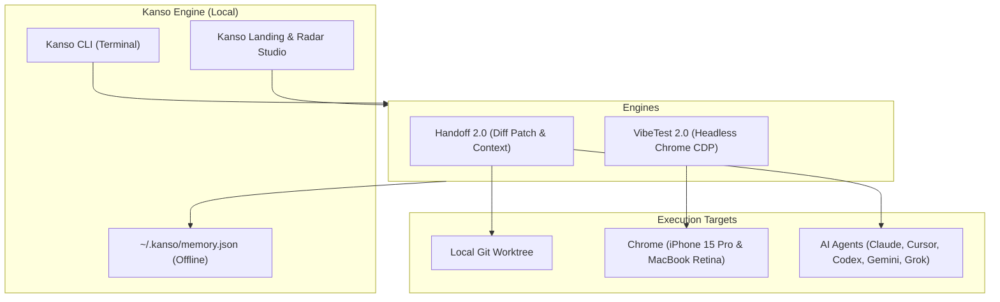

<div align="center">

# 簡素 · Kanso

### The Sovereign AI Assistant & Visual Studio
**100% Free · Local-First · Zero Cloud Dossiers · Apple-Grade Design**

[](https://opensource.org/licenses/MIT)
[](https://kanso.sh)
[](#)
[](#)

[Philosophy](#philosophy) • [Why Not Muse?](#why-not-meta-muse) • [Core Engines](#the-three-pillars) • [Quickstart](#quickstart) • [CI/CD Gate](#cicd-visual-gate) • [Architecture](#system-architecture)

</div>

---

> **"Kanso (簡素) — Simplicity, the elimination of clutter, and the pursuit of what is essential."**  
> *The Zen aesthetic principle that inspired Steve Jobs and Apple's timeless design philosophy.*

---

## Why Not Meta Muse?

While closed AI assistants sell $20–$100/month subscriptions to build advertising dossiers from your emails and code, **Kanso is completely sovereign and local-first**:

| Feature | **Meta Muse / Closed Apps** | **Kanso (簡素)** |
| :--- | :--- | :--- |
| **Pricing** | $20/mo (*Power*) to $100/mo (*Maximum*) | **100% Free Forever** (MIT License) |
| **Privacy & Telemetry** | Cloud dossiers harvested for ad targeting | **Zero Cloud Telemetry**. 100% offline |
| **Visual UI Eyes** | Blind to layout bugs & CSS regressions | **VibeTest 2.0** (CDP headless Chrome radar) |
| **Multi-Agent Handoff** | Proprietary lock-in, wiped on session timeouts | **Universal Handoff 2.0** (Git diffs + patches) |
| **CI/CD Automation** | Expensive enterprise team tiers | **Included** (`kanso vibe --ci --threshold 85`) |
| **Model Freedom** | Locked to Meta Llama cloud | **Any Model** (Claude, Cursor, Codex, Gemini, Grok) |

---

## Quickstart

### 1-Line Sovereign Install
```bash
curl -fsSL https://kanso.sh/install.sh | sh
```

### Or via npm
```bash
npm install -g kanso
```

Run pre-flight check:
```bash
kanso doctor
```

---

## The Three Pillars

```
┌────────────────────────────────────────────────────────────────────────┐
│                                K A N S O                               │
├────────────────────┬────────────────────┬──────────────────────────────┤
│  1. VIBETEST RADAR │  2. AGENT HANDOFF  │  3. EPISODIC MEMORY          │
│  - iPhone 15 Pro   │  - Git Diff Patch  │  - 100% Offline SQLite/JSON  │
│  - Contrast Audit  │  - Universal Baton │  - Smart Relevance Ranking   │
│  - Void Detection  │  - 1-Click Apply   │  - Project Scoping           │
└────────────────────┴────────────────────┴──────────────────────────────┘
```

### 1. `kanso vibe` — Visual Layout Eyes for AI-Built Apps
AI coding models write CSS at blazing speed, but they cannot see when they break your mobile layout:
```bash
kanso vibe http://localhost:5173
```
* **Mobile Viewport Overflow**: Flags elements wider than 393px causing horizontal scroll leaks on mobile.
* **Whitespace Void Catcher**: Flags unintended >85px dead zones between layout blocks.
* **Contrast & Alpha-Blending**: Computes luminance and WCAG contrast ratios, including translucent glass overlays over dark canvases.
* **Interactive HTML Reports**: Generates `.kanso/vibe-reports/report.html` with dual-viewport captures.

### 2. `kanso handoff` — Universal Multi-Agent Baton Pass
When Claude Code, Cursor, Codex, or Gemini hits a quota or gets stuck, never re-explain your project from scratch:
```bash
# Capture full git diffs, working tree status, and next steps
kanso handoff "Refactor Stripe checkout and fix mobile gap"

# Inspect the diff snapshot
kanso handoff diff

# Seamlessly apply the patch to another worktree or machine
kanso handoff apply

# Resume with a prompt formatted for any model
kanso handoff resume
```
Outputs `.kanso/handoff.patch`, `.kanso/handoff.json`, and human-readable `HANDOFF.md`.

### 3. `kanso memory` — Sovereign Episodic Memory
Store hard-won engineering gotchas and personal preferences locally (`~/.kanso/memory.json`):
```bash
# Store an insight with project scoping
kanso remember --topic "Tailwind Void" --insight "Check pt-20 navbar offset" --solution "Reset container padding" --project "ecommerce"

# Recall offline with smart relevance ranking
kanso recall "navbar void"

# List recent learnings
kanso memory list
```

---

## 4. `kanso studio` — Tri-Device Visual Canvas (localhost:3100)

Never resize your browser or guess how mobile renders. Launch the sovereign HUD:
```bash
kanso studio http://localhost:5173
```
* **Simultaneous Tri-Device Rendering**: Inspects iPhone 15 Pro (`393px`), iPad Mini (`768px`), and MacBook Retina (`1440px`) live on one canvas.
* **Instant Re-Auditing**: Trigger VibeRadar scans directly from the top HUD.
* **One-Click Handoff**: Snapshot current workspace state and diffs into `.kanso/handoff.patch`.
* **Zero Cloud Latency**: Runs 100% locally on your machine.

---

## 5. `kanso fix` — Automated Visual Self-Healing

When VibeTest detects visual defects (mobile overflows, voids, or invisible text):
```bash
kanso fix
```
Formulates a precision repair plan, identifies offending components, and formats self-healing instructions for Claude, Cursor, Codex, or your local model.

---

## 6. The Kanso Hub (`kanso hub` & `kanso pull`)

The open-source registry for agent memory packs and visual rules:
```bash
# Browse official curated packs
kanso hub

# Install heuristics directly into ~/.kanso/memory.json
kanso pull memory/tailwind-gotchas
kanso pull memory/nextjs-gotchas
kanso pull memory/ios-safari
kanso pull memory/nvidia-nim
```

---

## CI/CD Visual Gate

Block visual regressions, broken contrast, and mobile overflow from reaching production:

```bash
# Initialize CI workflow in 1 second
kanso init http://localhost:4173 --ci
```

This creates `.github/workflows/vibe.yml`:
```yaml
name: Kanso VibeScore Radar
on: [push, pull_request]

jobs:
  visual-gate:
    runs-on: ubuntu-latest
    steps:
      - uses: actions/checkout@v4
      - uses: actions/setup-node@v4
        with:
          node-version: 20
      - run: npm ci && npm run build
      - run: npm run preview & npx wait-on http://localhost:4173
      - name: Visual Regression Gate
        run: npx kanso vibe http://localhost:4173 --ci --threshold 85
```

---

## Embeddable Badge

Show off your application's visual quality:
```bash
kanso badge 100
```

[](https://kanso.sh)

```markdown
[](https://kanso.sh)
```

---

## System Architecture



---

## Philosophy & Values

1. **Simplicity Over Clutter (簡素)**: Every command, flag, and metric must earn its place.
2. **Sovereignty**: Your code, keys, and memory belong strictly to you. No cloud databases.
3. **Speed**: Sub-second deterministic checks. No loading spinners where simple math will do.

---

## License

MIT License © 2026 Andrew Express Agency & Kanso Contributors.
