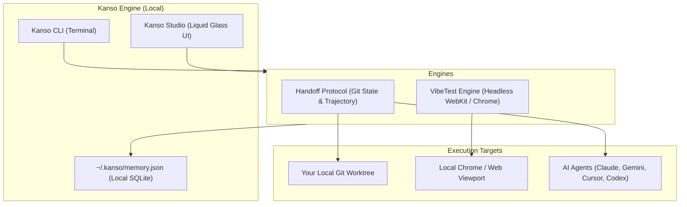

<div align="center">

# 簡素 · Kanso

### The Sovereign AI Assistant & Visual Studio
**100% Free · Local-First · Zero Cloud Dossiers · Apple-Grade Design**

[](https://opensource.org/licenses/MIT)
[](#)
[](#)

[Philosophy](#philosophy) • [Why Not Muse?](#why-not-muse) • [Core Engines](#the-three-pillars) • [Quickstart](#quickstart) • [Architecture](#architecture)

</div>

---

> **"Kanso (簡素) — Simplicity, the elimination of clutter, and the pursuit of what is essential."**  
> *The Zen aesthetic principle that inspired Steve Jobs and Apple's design philosophy.*

---

## Why Not Meta Muse?

While Big Tech sells $20–$100/month subscriptions to build advertising dossiers from your emails and browser history, **Kanso is completely sovereign**:

| Feature | **Meta Muse** | **Kanso (簡素)** |
| :--- | :--- | :--- |
| **Pricing** | $20/mo (*Power*) to $100/mo (*Maximum*) | **100% Free Forever** (MIT License) |
| **Privacy & Telemetry** | Meta builds background advertising dossiers | **Zero Cloud Dossier**. 100% local on your machine |
| **Browser Execution** | Cloud VM (frequently blocked by Amazon/Cloudflare) | **Local Browser** (uses your real human session) |
| **Model Choice** | Locked to Meta Llama cloud | **Any Model** (Claude, OpenAI, Gemini, or local Ollama) |
| **UI Testing Eyes** | Blind to layout bugs & CSS regressions | **Integrated `vibetest`** (catches mobile voids & contrast) |
| **Context Longevity** | Session timeouts wipe agent context | **Integrated `handoff`** (universal agent-to-agent baton pass) |

---

## The Three Pillars

```
┌────────────────────────────────────────────────────────────────────────┐
│                                K A N S O                               │
├────────────────────┬────────────────────┬──────────────────────────────┤
│  1. DAILY ASSISTANT│  2. VIBETEST RADAR │  3. UNIVERSAL HANDOFF        │
│  - ⌥ Space HUD     │  - Split Canvas    │  - Git diff snapshot         │
│  - Local Memory    │  - Void Catcher    │  - Agent baton pass          │
│  - Real Browser    │  - Contrast Audit  │  - 1-Click model hot-swap    │
└────────────────────┴────────────────────┴──────────────────────────────┘
```

### 1. `kanso handoff` — Universal Agent-to-Agent Baton Pass
When an AI agent (Claude Code, Cursor, Codex, Gemini) hits a token limit, daily quota, or gets stuck, never re-explain your project from scratch:
```bash
# Capture full git diffs, status, and task context
kanso handoff "Refactor auth and fix mobile gap"

# Resume in any new window or model
kanso handoff resume
```
Outputs a standardized `HANDOFF.md` and `.kanso/handoff.json` that any model can ingest in milliseconds.

### 2. `kanso vibe` — Visual Layout Eyes for AI-Built Apps
AI coding agents write CSS fast, but they can't see when they break your mobile layout:
```bash
kanso vibe http://localhost:5173
```
* **Contrast & Invisible Elements**: Flags text or transparent marks matching the background (e.g. black-on-black).
* **Whitespace Void Catcher**: Flags unintended >80px padding/margin voids on mobile viewports.
* **Mobile Viewport Overflow**: Catches elements wider than 390px causing horizontal scroll leaks.
* **Generates Markdown Reports**: Directly structured for coding agents to self-heal their CSS.

### 3. `kanso memory` — Sovereign Episodic Memory
Store hard-won engineering gotchas and personal preferences locally:
```bash
# Store an insight
kanso remember --topic "Tailwind Void" --insight "Check pt-20 navbar offset" --solution "Reset container padding"

# Recall anytime offline
kanso recall "void"
```

---

## Quickstart

### Installation

```bash
# Via npm
npm install -g kanso

# Or run instantly via npx
npx kanso --help
```

---

## System Architecture



---

## Philosophy & Values

1. **Simplicity Over Clutter**: Every button, flag, and metric must earn its place.
2. **Sovereignty**: Your files, API keys, and memory belong to you. We do not maintain user databases.
3. **Speed**: Sub-second deterministic checks. No loading spinners where simple math will do.

---

## License

MIT License © 2026 Andrew Express Agency & Kanso Contributors.
